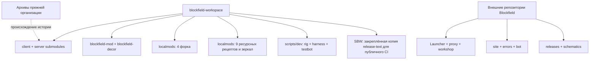

# Архитектура Blockfield

Точка входа для работы между репозиториями. Карта проверена по `.gitmodules`,
локальным исходникам и руководствам 2026-10-08. Описание связи подтверждает код,
а не факт её выпуска или развёртывания. Невыпущенные изменения отмечены отдельно.

Перед работой прочитайте [AGENTS.md](../AGENTS.md) и [DEVELOPING.md](DEVELOPING.md).
Код и подробный контракт меняются в репозитории-владельце. При изменении связи
обновляйте эту карту и документ владельца контракта; исторические отчёты и
свидетельства сохраняйте. Версии и SHA берите из gitlinks, lock-файлов и
опубликованных манифестов, а не из этой страницы.

## 1. Репозитории и расположение

Пути в таблицах заданы **от корня workspace**, с учётом регистра. GitHub-ссылки
канонические; приватный репозиторий требует доступа, иначе GitHub показывает 404.
Соседние клоны не обязательны для установки опубликованного пака.

### Workspace и все submodules

Все 17 submodules (два пака и 15 каталогов `localmods/`) перечислены ниже.
Полный состав задаёт [`.gitmodules`](../.gitmodules). Исходники
коммитятся в своих репозиториях; workspace закрепляет согласованный набор SHA.
Общий [формат исходников](FORMATTING.md) закрепляется собственными
`.editorconfig` и `.gitattributes` в каждом активном репозитории Blockfield.

| Репозиторий                                                                                | Путь                                   | Назначение                                              | Руководство                                                                                                                                                                     |
| ------------------------------------------------------------------------------------------ | -------------------------------------- | ------------------------------------------------------- | ------------------------------------------------------------------------------------------------------------------------------------------------------------------------------- |
| [blockfield-workspace](https://github.com/Blockfield/blockfield-workspace) | `.`                                    | Dev/rig, harness, проверки, связь исходников            | [DEVELOPING](DEVELOPING.md)                                                                                                                                                     |
| [blockfield-client](<private-submodule>)                       | `client/`                              | Пины клиента, ресурсы, архивы и Blockfield-web.tar      | [README](<private-submodule>/blob/main/README.md), [release notes](<private-submodule>/blob/main/docs/RELEASE-NOTES.md) |
| [blockfield-server](<private-submodule>)                       | `server/`                              | Пины сервера, конфиги, карты, образ и выпуск            | [DEVELOPING](<private-submodule>/blob/main/docs/DEVELOPING.md), [DEPLOY](<private-submodule>/blob/main/docs/DEPLOY.md)  |
| [blockfield-mod](<private-submodule>)                             | `localmods/blockfield-mod/`            | Игровая логика, сетевые сообщения, клиентский интерфейс | [CLAUDE](<private-submodule>/blob/main/CLAUDE.md) и целиком [AGENTS](<private-submodule>/blob/main/docs/AGENTS.md)            |
| [blockfield-decor](<private-submodule>)                         | `localmods/blockfield-decor/`          | Общие статичные блоки декора с сохранением старых ID    | [README](<private-submodule>/blob/main/README.md)                                                                                                    |
| [create-fabric](https://github.com/Blockfield/create-fabric)                               | `localmods/create-fabric/`             | Форк Create для Fabric                                  | [README](https://github.com/Blockfield/create-fabric/blob/main/README.md)                                                                                                       |
| [parcool-fabric](https://github.com/Blockfield/parcool-fabric)                             | `localmods/parcool-fabric/`            | Форк ParCool, движения и стамина                        | [README](https://github.com/Blockfield/parcool-fabric/blob/main/README.md)                                                                                                      |
| [superbwarfare-fabric](https://github.com/Blockfield/superbwarfare-fabric)                 | `localmods/superbwarfare-fabric/`      | Порт SBW: оружие, транспорт, дроны                      | [README](https://github.com/Blockfield/superbwarfare-fabric/blob/main/README.md), [порт](https://github.com/Blockfield/superbwarfare-fabric/blob/main/PORT-BRIEF.md)            |
| [simplebedrockmodel-fabric](https://github.com/Blockfield/simplebedrockmodel-fabric)       | `localmods/simplebedrockmodel-fabric/` | Форк рендера и анимаций Bedrock                         | [README](https://github.com/Blockfield/simplebedrockmodel-fabric/blob/main/README.md)                                                                                           |
| [blockfield-music](<private-submodule>)                         | `localmods/blockfield-music/`          | Музыка и рецепт ресурсного JAR                          | [README](<private-submodule>/blob/main/README.md)                                                                                                    |
| [cozy-home](<private-submodule>)                                       | `localmods/cozy-home/`                 | Патчи ресурсов Cozy Home                                | [README](<private-submodule>/blob/main/README.md)                                                                                                           |
| [elite-x](<private-submodule>)                                           | `localmods/elite-x/`                   | Рецепт Elite X, иконки, общий инструмент animsync       | [README](<private-submodule>/blob/main/README.md)                                                                                                             |
| [gucci-vuitton-attachment](<private-submodule>)         | `localmods/gucci-vuitton-attachment/`  | Исходники и упаковка дополнительного ганпака            | [README](<private-submodule>/blob/main/README.md)                                                                                            |
| [lr-tactical](<private-submodule>)                                   | `localmods/lr-tactical/`               | Рецепт патчей LR Tactical                               | [README](<private-submodule>/blob/main/README.md)                                                                                                         |
| [porting-lib](<private-submodule>)                                   | `localmods/porting-lib/`               | Зеркало неизменённых зависимостей Create                | [README](<private-submodule>/blob/main/README.md)                                                                                                         |
| [tacz-refabricated](<private-submodule>)                       | `localmods/tacz-refabricated/`         | Рецепт патчей TaCZ и потребитель animsync               | [README](<private-submodule>/blob/main/README.md)                                                                                                   |
| [vanilla-backport](<private-submodule>)                         | `localmods/vanilla-backport/`          | Патчи ресурсов Vanilla Backport                         | [README](<private-submodule>/blob/main/README.md)                                                                                                    |
| [yuushya](<private-submodule>)                                           | `localmods/yuushya/`                   | Патчи Yuushya                                           | [README](<private-submodule>/blob/main/README.md)                                                                                                             |

Рецепт патча или зеркало артефактов не означает владение исходным сторонним модом.
Upstream и лицензии указаны в README соответствующего репозитория.

### Связанные репозитории вне submodules

| Репозиторий                                                                      | Локальное расположение            | Назначение                                                                                       | Руководство                                                                                                                                                                                                                                           |
| -------------------------------------------------------------------------------- | --------------------------------- | ------------------------------------------------------------------------------------------------ | ----------------------------------------------------------------------------------------------------------------------------------------------------------------------------------------------------------------------------------------------------- |
| [Blockfield-Launcher](https://github.com/Blockfield/Blockfield-Launcher)         | `../Blockfield-Launcher/`         | Tauri UI, аккаунт, установка Java/игры/пака, deep links и Discord RPC                            | [README](https://github.com/Blockfield/Blockfield-Launcher/blob/main/README.md), [DEVELOPMENT](https://github.com/Blockfield/Blockfield-Launcher/blob/main/docs/DEVELOPMENT.md)                                                                       |
| [blockfield-proxy](https://github.com/Blockfield/blockfield-proxy)               | `../blockfield-proxy/`            | Velocity, аутентификация, маршрутизация и отдельное Limbo-лобби                                  | [README](https://github.com/Blockfield/blockfield-proxy/blob/main/README.md)                                                                                                                                                                          |
| [blockfield-workshop](https://github.com/Blockfield/blockfield-workshop)         | `../blockfield-workshop/`         | Host-controller, кандидаты и версии карт                                                         | [OPERATIONS](https://github.com/Blockfield/blockfield-workshop/blob/main/docs/OPERATIONS.md), [AGENTS](https://github.com/Blockfield/blockfield-workshop/blob/main/AGENTS.md)                                                                         |
| [blockfield-site](https://github.com/Blockfield/blockfield-site)                 | `../../../Web/blockfield-site/`   | Astro SSR, аккаунт, комнаты, статистика и админка                                                | [README](https://github.com/Blockfield/blockfield-site/blob/main/README.md), [admin](https://github.com/Blockfield/blockfield-site/blob/main/docs/admin.md), [statistics](https://github.com/Blockfield/blockfield-site/blob/main/docs/statistics.md) |
| [blockfield-errors](https://github.com/Blockfield/blockfield-errors)             | `../../../Web/blockfield-errors/` | Общие HTTP-ошибки Blockfield, renderer и Traefik-правила                                         | [README](https://github.com/Blockfield/blockfield-errors/blob/main/README.md)                                                                                                                                                                         |
| [blockfield-bot](https://github.com/Blockfield/blockfield-bot)                   | `../../../Bots/blockfield-bot/`   | Discord: тикеты, форумы, анонсы релизов; самостоятельный Go-сервис                               | [README](https://github.com/Blockfield/blockfield-bot/blob/main/README.md), [DEPLOY](https://github.com/Blockfield/blockfield-bot/blob/main/docs/DEPLOY.md)                                                                                           |
| [blockfield-releases](https://github.com/Blockfield/blockfield-releases)         | `../blockfield-releases/`         | Публичные клиентские артефакты и обращения игроков                                               | [README](https://github.com/Blockfield/blockfield-releases/blob/main/README.md)                                                                                                                                                                       |
| [blockfield-distribution](https://github.com/Blockfield/blockfield-distribution) | `../blockfield-distribution/`     | Nginx перед blockfield.pro: раздаёт пак с хоста (путь — в приватной документации раздачи), fallback на сайт | [README](https://github.com/Blockfield/blockfield-distribution/blob/main/README.md)                                                                                                                                                                   |
| [blockfield-schematics](https://github.com/Blockfield/blockfield-schematics)     | В workspace не клонирован         | WorldEdit-схемы одиночной игры клиента; бинарные входы в R2, не карты серверной мастерской       | [README](https://github.com/Blockfield/blockfield-schematics/blob/main/README.md), [ASSETS](ASSETS.md)                                                                                                                                                |

Сайт и errors могут иметь совместимые ссылки из старого соседнего каталога;
каноническое место их рабочих клонов — `Projects/Web`. Прежний адрес репозитория
лаунчера (до переименования в Blockfield) перенаправляет в Blockfield: это переименование,
а не отдельный архивный продукт.

### Зависимости и архивы

Minecraft, Fabric, Fantasy, Accessories, WorldEdit, TaCZ и остальные сторонние
моды потребляются по пинам сборок. Компиляционные зависимости мода закреплены в
его `build.gradle`; источники форков и рецептов перечислены выше. Они не являются
сервисами, которые запускает workspace самостоятельно.

Архивные репозитории прежней организации (модпак и мод) сохраняют
прежнюю историю и опубликованные входы. Их не правят и не используют как рабочий
монолит. Старое имя `blockfield-web` неоднозначно: бывший сайт теперь
`blockfield-site`, прежний образ раздачи с паком (пакет GHCR `blockfield-distribution`) заменён
репозиторием `blockfield-distribution` (nginx, пакет `blockfield-nginx`) и данными пака на хосте. Исторические имена в свидетельствах и rollback-описаниях
остаются неизменными.

Схема ниже показывает владение исходниками, **не сетевые вызовы**:



Публичный `superbwarfare-fabric` хранит точную копию `.github/actions/release-text`:
GitHub не загружает action приватного workspace в публичный workflow. Workspace
владеет реализацией; SHA источника и checksums находятся в `PROVENANCE.md` и
`SHA256SUMS` копии. Обновление копии сохраняет этот контракт и штатный текст из
фактов при недоступной генерации; отсутствие `announcement.json` не считается
готовым анонсом.

## 2. Подсистемы и точки входа

| Владелец         | Основные каталоги / точки входа                                                                                                                                                                                                                                        | Где читать подробности                                                                                                                                                                                                                                                           |
| ---------------- | ---------------------------------------------------------------------------------------------------------------------------------------------------------------------------------------------------------------------------------------------------------------------- | -------------------------------------------------------------------------------------------------------------------------------------------------------------------------------------------------------------------------------------------------------------------------------- |
| Workspace        | `justfile` → `bf.py` → `scripts/dev/devstack.py`; `scripts/toolchain.py`, `scripts/quality.py`; `localmods/mods.json.example`; `scripts/dev/{watch,media,windows_headless}.py`, `scenarios/`, `mcp/{server,game}.py`, `testbot/`; `.dev/` и `temp/` — локальные данные | [DEVELOPING](DEVELOPING.md), [ASSETS](ASSETS.md)                                                                                                                                                                                                                                 |
| Client           | `pack.toml`, `index.toml`, `mods/`, `config/`, `resources.lock.json`; `scripts/{build-client,packlib}.py`; `scripts/pack-swap.py`; `.github/workflows/`, `release-notes/`                                                                                              | [README](<private-submodule>/blob/main/README.md), [release notes](<private-submodule>/blob/main/docs/RELEASE-NOTES.md)                                                                                                  |
| Server           | `pack.toml`, `mods/`, `server/lobby/{blockfield,config,datapacks}`; `scripts/build-distribution.py`, `scripts/maps/`; `distribution/{start-container.sh,*.lock.json}`; `scripts/pack-swap.py`; `tools/codre-maps/`                                                     | [DEVELOPING](<private-submodule>/blob/main/docs/DEVELOPING.md), [DEPLOY](<private-submodule>/blob/main/docs/DEPLOY.md), [CODRE-MAPS](<private-submodule>/blob/main/docs/CODRE-MAPS.md)       |
| Игровой мод      | `common/` — предметы, DTO и сеть; `client/` — `BlockFieldClient`, tablet/HUD, render, миксины; `server/` — `BlockFieldServer`, `core/{Hub,Room,MatchWorld}`, `modes/`, `training/`, `policy/`, `statistics/`, workshop                                                 | [AGENTS](<private-submodule>/blob/main/docs/AGENTS.md), [producer](<private-submodule>/blob/main/docs/statistics/PRODUCER.md), [admin settings](<private-submodule>/blob/main/docs/admin-settings.md) |
| Decor / форки    | Gradle `src/`, ресурсы и отдельные release workflows; decor — общий JAR, игровой мод — отдельные client/server JAR с общими классами                                                                                                                                   | README в таблице репозиториев                                                                                                                                                                                                                                                    |
| Рецепты ресурсов | `scripts/patch.py` или `build.py`, исходные ресурсы, checksum; Elite X владеет `scripts/animsync.py`, TaCZ потребляет закреплённый инструмент                                                                                                                          | README рецептов; [воспроизводимость](DEVELOPING.md#воспроизводимость-рецептов)                                                                                                                                                                                                   |
| Launcher         | `src/` — UI; `src-tauri/src/{commands,minecraft,account,status,rooms}.rs`; `launcher.json`; `src-tauri/tauri.conf.json`; updater/release workflows                                                                                                                     | [DEVELOPMENT](https://github.com/Blockfield/Blockfield-Launcher/blob/main/docs/DEVELOPMENT.md), [rooms/Discord](https://github.com/Blockfield/Blockfield-Launcher/blob/main/docs/ROOMS-AND-DISCORD.md)                                                                           |
| Proxy            | `proxy/plugin/`: `BlockfieldProxy` регистрирует `Authentication`, `BackendRouting`, `LoginForwarding`; `Gate`, `Sessions`, startup `LimboSelection`; `proxy/velocity.toml`, `proxy/lobby/`, `proxy/limbo/*.patch`; `distribution/`                                     | [README](https://github.com/Blockfield/blockfield-proxy/blob/main/README.md)                                                                                                                                                                                                     |
| Workshop         | `controller.py`, `docker_backend.py`, `workshopctl.py`, `candidates.py`, `map_package.py`, `limbo.py`, `journal.py`, `map_ids.json`; `systemd/`, `Dockerfile`, `e2e/`                                                                                                  | [OPERATIONS](https://github.com/Blockfield/blockfield-workshop/blob/main/docs/OPERATIONS.md)                                                                                                                                                                                     |
| Site             | `src/pages/`, API routes; `src/lib/{admin,settings-form,account,rooms,stats,database,glicko2,launcher}.ts`; `public/`, `test/`, `scripts/`; Astro SSR entrypoint; команды pnpm                                                                                         | [admin](https://github.com/Blockfield/blockfield-site/blob/main/docs/admin.md), [statistics](https://github.com/Blockfield/blockfield-site/blob/main/docs/statistics.md), [DESIGN](https://github.com/Blockfield/blockfield-site/blob/main/DESIGN.md)                            |
| Bot              | `main.go`, `internal/{tickets,forums,news}`; JSON под `/app/data`; Go checks, GHCR image, deploy webhook                                                                                                                                                               | [DEPLOY](https://github.com/Blockfield/blockfield-bot/blob/main/docs/DEPLOY.md)                                                                                                                                                                                                  |
| Errors           | Самостоятельный HTML-шаблон, `compose.yaml`, `traefik.yml`, `global-errors.yml`, тесты renderer; не часть Astro                                                                                                                                                        | [README](https://github.com/Blockfield/blockfield-errors/blob/main/README.md)                                                                                                                                                                                                    |
| Releases         | README для игроков, GitHub Releases с архивами клиента, `build.json`, checksum и release notes; не источник игрового кода                                                                                                                                              | [README](https://github.com/Blockfield/blockfield-releases/blob/main/README.md)                                                                                                                                                                                                  |

Игровой dev/rig запускается **из workspace**, на Linux и Windows без Docker.
Отдельные dev-архивы и dev-лаунчер больше не являются рабочим способом запуска.
Запуск/остановка принадлежат `scripts/dev/devstack.py`: локальные PID-записи
и session owner, native Linux pidfd (`linux_process.py`) / Windows process handle
(`windows_process.py`). Личный helper не требуется; политика владения —
[AGENTS.md](../AGENTS.md#владение-процессами), цикл запуска —
[DEVELOPING](DEVELOPING.md#собственный-локальный-стенд).
Production workshop-controller использует Docker Swarm на Linux: это другая
область, не требование к harness разработчика.

`just iterate both` выполняет однократный Java-HMR через watcher: fingerprints
исходников, установленного JAR и собственного процесса позволяют пропустить
неизменившуюся сторону. Общие Java-изменения выбирают обе стороны; все нужные
сборки завершаются до первого применения. `watch-receipt.json` — отдельная
запись dev-итерации, привязанная к SHA256 полного базового серверного `build.json`.
Она может подтвердить только точный установленный Blockfield server JAR;
manifest, digest пака и проверка остальных модов сохраняются.
Ресурсы и зависимости обновляются полным циклом на остановленном стенде.

Агентский клиент использует собственный backend: Linux Xvfb, Windows x64 —
неинтерактивные window station/desktop с явным `STARTUPINFO.lpDesktop` и
проверкой WGL/software Mesa `26.2.2` до Minecraft. DLL устанавливаются в отдельную
копию JDK, developer JDK сохраняется; headless-аудио использует OpenAL No Output.
Нативный Windows CI подтвердил изоляцию дочернего окна.
`just play --headless --probe --released-pack` готовит закреплённый публичный
клиент Blockfield `v2.63.0` без credentials и автоматически проверяет меню,
реальный рендер, ввод, capture и restart на обеих ОС. Без `--released-pack`
сохраняется базовая проверка Minecraft/Fabric/testbot. CI запускает вариант
с опубликованным паком; это отдельная приёмка клиентского runtime, которая
не подтверждает серверный бой, несколько клиентов или текущие локальные моды.
`bf_state.screenKind` сохраняет семантические имена ванильных меню после remapping;
video offsets связывают время MP4 с фактическими временами capture manifest.

## 3. Межрепозиторные контракты

В колонке «проверять» указаны владельцы обеих сторон связи. Контракт определяет
набор проверок, а `side`, compatibility и protocol — необходимость парного выпуска.

Встроенный клиентский пак мода `gun_overrides` заменяет анимации TaCZ, Elite X и
LR Tactical по исходным `assets/<namespace>/animations/*.animation.json` путям
через Fabric `ALWAYS_ENABLED`. Владелец подгонки — mod client; источники, SHA и
границы изменений — его `resourcepacks/gun_overrides/PROVENANCE.md`. Геометрия,
текстуры и серверные данные остаются у производителей. Проверяйте сборку мода,
приоритет ресурсов и native хват/use/throw на закреплённых upstream JAR, в том
числе без шейдеров. Изменение серверных времён требует сверки обоих потребителей.

Defaults доставания основного оружия задаёт серверный датапак `blockfield_balance`.
Соответствующие `draw`/`draw_empty` и draw-звуки находятся в клиентском
`gun_overrides`; таблица времени — в его `PROVENANCE.md`. Меняйте и проверяйте
датапак и ресурспак вместе: серверная готовность должна совпадать с завершением
движения, звуковые фазы — сохранять синхронность, быстрый переход к пистолету —
сохраняться. Звуковой хвост может продолжаться после готовности.

| Источник → потребитель                                     | Механизм / формат                                                                                                                                                                                                                                                                                                                                                                                                              | Владелец и определение контракта                                                                                                                                                                                                                                                                  | Проверять при изменении                                                                                 |
| ---------------------------------------------------------- | ------------------------------------------------------------------------------------------------------------------------------------------------------------------------------------------------------------------------------------------------------------------------------------------------------------------------------------------------------------------------------------------------------------------------------ | ------------------------------------------------------------------------------------------------------------------------------------------------------------------------------------------------------------------------------------------------------------------------------------------------- | ------------------------------------------------------------------------------------------------------- |
| Моды, форки, ресурсы → client/server                       | GitHub/R2 артефакты + immutable URL/hash, packwiz `*.pw.toml`, resource locks, `side`                                                                                                                                                                                                                                                                                                                                          | Client `scripts/packlib.py`, server `scripts/build-distribution.py`, README производителя                                                                                                                                                                                                         | Производитель, client, server; workspace overlay                                                        |
| Elite X → TaCZ recipe                                      | Закреплённый animsync source/tool и checksum                                                                                                                                                                                                                                                                                                                                                                                   | Elite X `scripts/animsync.py`; TaCZ tool lock и tests; [DEVELOPING](DEVELOPING.md#воспроизводимость-рецептов)                                                                                                                                                                                     | Elite X, TaCZ, обе сборки при изменении артефактов                                                      |
| Client ↔ server сборки                                     | Compatibility SHA256: общие моды, ресурсы, Minecraft/Fabric, явный protocol; server читает `build.json`, не исходники клиента                                                                                                                                                                                                                                                                                                  | `client/compatibility.json`, `server/client-compatibility.json`, [DEPLOY](<private-submodule>/blob/main/docs/DEPLOY.md)                                                                                                                                               | Client, server, изменённые общие моды и wire-протокол                                                   |
| Game service → Workshop service                            | Тот же тег `blockfield-server:latest` без digest: Swarm скачивает его при каждом старте workshop/test; общие JAR, `build.json` и PackVersionGate совпадают с игрой                                                                                                                                                                                                                                                             | Панель развёртывания (запись сервиса воркшопа), [OPERATIONS](https://github.com/Blockfield/blockfield-workshop/blob/main/docs/OPERATIONS.md#workshop-image)                                                                                                                                                        | Выпуски сервера/клиента не требуют сборки и Deploy Workshop; не закреплять сервис по digest             |
| Client → proxy → server login                              | `blockfield:pack_contract`: `<contract>:<PROTOCOL>`; без ответа — `pack_version`: хеш пака, live override привязан к образу; launcher читает только раздаваемый `current`, staged prerelease невидим                                                                                                                                                                                                                           | Mod `PackContract`, `PackVersion`, `PackUpdates`, `PackVersionGate`, `AcceptedPack`; proxy `LoginForwarding`; build/deploy scripts                                                                                                                                                                | Mod client/server, proxy, обе сборки/deploy                                                             |
| Client prerelease → staging → pair switch                  | Тег клиента → GitHub prerelease; auto Deploy client успешно подготавливает пак (`stage`) без смены `current`/gate/Latest. После candidate/CI/тега Deploy server с `client_tag` переключает сервер, gate и пак; затем Deploy client снимает prerelease и ставит Latest                                                                                                                                                          | Client `client.yml`, `deploy-client.py`, `deploy.yml`; server `pack-swap.py stage`, `deploy.yml`; [DEPLOY](<private-submodule>/blob/main/docs/DEPLOY.md)                                                                                                              | Client/server CI/deploy, prerelease/Latest, rollback, workspace pin                                     |
| Mod server → mod client                                    | Fabric C2S/S2C DTO, меню, команды, HUD и состояние боя                                                                                                                                                                                                                                                                                                                                                                         | `common/src/main/java/com/lunares/blockfield/network/`, `BlockFieldServer.handleMenuAction`, клиентские receivers; [AGENTS](<private-submodule>/blob/main/docs/AGENTS.md)                                                                                                | Обе половины мода, client/server protocol; launcher для bridge-действий                                 |
| Mod server ↔ mod client: F3+B хитбоксы                     | Опциональный S2C `blockfield:body_pose_debug`: committed frame отслеживаемых игроков раз в тик только подписанным клиентам; клиент рисует коробки частей вместо AABB, протокол не меняется                                                                                                                                                                                                                                     | Mod `BodyPoseDebug{S2CPacket,SubscribeC2SPacket,Stream}`, `BodyPartHitboxRenderer`; [BODY-POSES](<private-submodule>/blob/main/docs/BODY-POSES.md)                                                                                                                       | Обе половины мода; удалить в фазе 3                                                                     |
| Game → site: результаты                                    | Durable outbox → `POST /api/stats/results`, schemaVersion 1, server UUID, event UUID, bearer key; идемпотентный replay                                                                                                                                                                                                                                                                                                         | [mod producer](<private-submodule>/blob/main/docs/statistics/PRODUCER.md), site `src/lib/stats.ts:validateResult`, [statistics](https://github.com/Blockfield/blockfield-site/blob/main/docs/statistics.md)                                                              | Mod statistics/common DTO, site, server env; импорт исторических данных                                 |
| Game → site: диагностика сервера                           | `POST /api/stats/diagnostics`, schemaVersion 1, тот же server UUID/bearer key; минутные TPS/MSPT/heap/GC, фризы и очищенные игровые ошибки; ограниченный memory buffer, идемпотентный retry                                                                                                                                                                                                                                    | Mod `server/statistics/{DiagnosticsReporter,DiagnosticsBuffer,StatsHttpTransport}`, [producer](<private-submodule>/blob/main/docs/statistics/PRODUCER.md); site `src/lib/diagnostics.ts`, [admin](https://github.com/Blockfield/blockfield-site/blob/main/docs/admin.md) | Mod tick/log hooks, site ingestion/storage/admin; серверные env результата остаются владельцем identity |
| Site → launcher / game UI: статистика                      | Публичные `/api/stats/{leaderboard,players,seasons}`, фильтры/рейтинги; game `StatsBoard` проксирует HTTP к tablet                                                                                                                                                                                                                                                                                                             | Site [statistics](https://github.com/Blockfield/blockfield-site/blob/main/docs/statistics.md); launcher `status.rs`; mod `server/statistics/StatsBoard`                                                                                                                                           | Site, launcher, mod; persisted schema/backups                                                           |
| Site ↔ база данных                                         | PostgreSQL через `pg` или SQLite через `node:sqlite`; migrations, transactions, рейтинг и staff roles                                                                                                                                                                                                                                                                                                                          | Site `src/lib/{database,stats,glicko2}.ts`, [statistics](https://github.com/Blockfield/blockfield-site/blob/main/docs/statistics.md)                                                                                                                                                              | Site, migration/import scripts; producer replay и все read clients                                      |
| Site ↔ workshop controller                                 | Atomic inbox `{schema,id,kind,actor,...}`; `candidate {commit:true,note}` = коммит + проверка одним шагом горячим снимком (`save-off`/`save-all flush`/`save-on`), мастерская не перезапускается; пустой черновик — отказ в `results/<id>.json`; read-only `status/session/members/candidates/results`; revision CAS и map ACL                                                                                                 | Site `src/lib/admin.ts`, [admin](https://github.com/Blockfield/blockfield-site/blob/main/docs/admin.md); controller [OPERATIONS](https://github.com/Blockfield/blockfield-workshop/blob/main/docs/OPERATIONS.md)                                                                                  | Site, workshop, mod workshop, proxy gate/ACL, host mounts                                               |
| Workshop mod → site → controller                           | Authenticated `/api/workshop/{access,submit}`; site проверяет роль/карту и пишет inbox `candidate {commit:true}`; планшет опрашивает `GET /api/workshop/submit?id=` и подтверждает только `result.ok`                                                                                                                                                                                                                          | Mod `core/WorkshopAccess`; site `handleWorkshopAccess/Submit`, [admin](https://github.com/Blockfield/blockfield-site/blob/main/docs/admin.md)                                                                                                                                                     | Mod, site, workshop; ACL формы и tablet                                                                 |
| Site → game settings → site                                | Atomic `settings.json` schema/revision; mod перечитывает каждые 5 с, пишет `applied.json`; ошибки/статус применения                                                                                                                                                                                                                                                                                                            | Mod [admin-settings](<private-submodule>/blob/main/docs/admin-settings.md), `policy/AdminSettings`, `core/AdminSettingsSync`; site `admin.ts`                                                                                                                            | Site, mod server, server shared directory/mount                                                         |
| Controller → proxy/site/game                               | `gate.json`, public state, members; host lock/readiness, независимые `backends.game/workshop` в schema-1 gate.json; Game наблюдается по readiness/release, controller управляет только Workshop/editor/test                                                                                                                                                                                                                    | Workshop [OPERATIONS](https://github.com/Blockfield/blockfield-workshop/blob/main/docs/OPERATIONS.md), proxy `Gate/BackendRouting`, site `rooms.ts`, server `distribution/start-container.sh`                                                                                                     | Workshop, proxy, site, server; profile/statistics purpose                                               |
| Workshop → game / server: карта                            | Native CAS delta/manifest → SSD bundle/head → MapVersion (ещё не выпущено); legacy ZIP export → pinned pack release                                                                                                                                                                                                                                                                                                            | Workshop `candidates.py:MapVersions`, `map_package.py`; mod `MapVersion`; server `distribution/{maps,workshop}.lock.json`, `scripts/maps/{workshop_source,publish_map,release_maps}.py`                                                                                                           | Workshop storage/activation, mod world loader; server release locks; site download                      |
| Game → site `/api/rooms` → launcher                        | SLP `blockfield` snapshot внутреннего game; site объединяет с публичным proxy ping/gate; launcher читает HTTP rooms                                                                                                                                                                                                                                                                                                            | Mod `RoomPresence/RoomStatusMixin`; site `src/lib/rooms.ts`; launcher `status.rs`; [rooms/Discord](https://github.com/Blockfield/Blockfield-Launcher/blob/main/docs/ROOMS-AND-DISCORD.md)                                                                                                         | Mod server, site, launcher, proxy/gate                                                                  |
| Site / Discord → launcher → Minecraft                      | `blockfield://join/lobby` или UUID; web fallback `/?room=...#rooms`; Discord `bf1:<target>`; локальный `room-request.json` → MenuAction                                                                                                                                                                                                                                                                                        | Launcher `rooms.rs`, `lib.rs`, `tauri.conf.json`; mod `LauncherBridge`; site `index.astro`; [rooms/Discord](https://github.com/Blockfield/Blockfield-Launcher/blob/main/docs/ROOMS-AND-DISCORD.md)                                                                                                | Site, launcher, mod client/server; errors join links                                                    |
| Launcher/site ↔ Drasl                                      | Yggdrasil authenticate/validate/refresh, account API; site держит API token в httpOnly cookie                                                                                                                                                                                                                                                                                                                                  | Launcher `account.rs`, site `account.ts` и `/api/account/*`; [site README](https://github.com/Blockfield/blockfield-site/blob/main/README.md)                                                                                                                                                     | Launcher, site, Drasl config; client auth handoff                                                       |
| Minecraft ↔ Drasl ↔ proxy                                  | `blockfield:auth`, join/hasJoined; proxy проверяет вход, не получает access token; remembered sessions JWT/HMAC                                                                                                                                                                                                                                                                                                                | Mod `DraslAuth/DraslSession`; proxy `Authentication/Sessions`; [proxy README](https://github.com/Blockfield/blockfield-proxy/blob/main/README.md)                                                                                                                                                 | Mod client, proxy, launcher, Drasl; logout/account сценарии сайта                                       |
| Client/launcher publishing → releases/distribution → игрок | GitHub Release: архивы, `Blockfield-web.tar`, build.json; `pack-swap.py` → симлинк пака → Nginx; launcher — своим repo. Зеркала (ещё не выпущено): `mirrors.json` → packwiz-installer bf3 выбирает Gcore (`cdn-test.blockfield.pro`, по пути), R2 `blockfield-pack` (`r2.blockfield.pro`, 30 дней) или релиз `files` в blockfield-pack-mirror (по хешу), `blockfield.pro` последним; launcher показывает `[blockfield-mirror]` | Client `.github/workflows/`, `scripts/pack-swap.py`; blockfield-distribution `nginx.conf.template`; launcher release/updater config; [DEPLOY](<private-submodule>/blob/main/docs/DEPLOY.md)                                                                           | Client, releases, launcher, site download lookup, bot announcements                                     |
| R2 → сборки / dev                                          | Immutable version prefixes и SHA256; чтение HTTPS assets.blockfield.pro, запись rclone/S3; `r2-url` приоритетнее origin URL                                                                                                                                                                                                                                                                                                    | [ASSETS](ASSETS.md), [реестр](assets-manifest.json), client/server locks и fetchers                                                                                                                                                                                                               | Производитель ресурса, client/server, workspace; публичный домен R2                                     |
| Release CI → release-text → releases                       | Action по полному SHA: факты (PR с коммитами, пины) → модель (`OPENROUTER_API_KEY`) → `release-notes.md`; клиенту отдельный запрос (`ANNOUNCEMENT_MODEL`, иначе `RELEASE_TEXT_MODEL`) → `announcement.json`; сбой даёт текст из фактов                                                                                                                                                                                         | Workspace `.github/actions/release-text`; `pr-text.yml` и релизные workflows владельцев                                                                                                                                                                                                           |
| Releases → bot → Discord                                   | GitHub `release:published` webhook + polling; `announcement.json` (иначе `release-notes.md`); подпись webhook; JSON состояния                                                                                                                                                                                                                                                                                                  | Bot `internal/news`, [README](https://github.com/Blockfield/blockfield-bot/blob/main/README.md)                                                                                                                                                                                                   |
| Launcher ↔ Discord RPC                                     | Rich Presence/invites; общий Application ID с ботом, токен бота не передаётся                                                                                                                                                                                                                                                                                                                                                  | Launcher rooms/RPC code, bot README                                                                                                                                                                                                                                                               | Launcher, site invite URLs, mod room admission; bot только Application ID                               |
| Actions → GHCR/Dokploy → сервисы                           | Проверенный image → `:latest` → secret deploy webhook; game pair lock/rollback; errors — отдельный Compose                                                                                                                                                                                                                                                                                                                     | Owner repo workflows/README; [server DEPLOY](<private-submodule>/blob/main/docs/DEPLOY.md), [bot DEPLOY](https://github.com/Blockfield/blockfield-bot/blob/main/docs/DEPLOY.md), workshop OPERATIONS                                                                  | Изменяемый сервис, его health probes, registry/mounts; не перезапускать proxy вместе с game             |
| Traefik → ошибки Blockfield                                | HTTP error middleware + original Host dispatcher; browser GET/HEAD 400–599, API/JSON/POST сохраняют ответы                                                                                                                                                                                                                                                                                                                     | Errors `traefik.yml`, `global-errors.yml`, `compose.yaml`, [README](https://github.com/Blockfield/blockfield-errors/blob/main/README.md)                                                                                                                                                          | Errors, HTTP services/router rules; игровой TCP router не участвует                                     |
| Harness MCP → собственный testbot/RCON                     | Ограниченные `bf_*` tools, job allowlists/evidence; owner/PID/TCP; `bf_wait_state`, tick-based `bf_sequence`, `bf_render_probe`, `bf_capture` с типизированными действиями и фактическими временами; raw callbacks своего окна без desktop API                                                                                                                                                                                 | Workspace `scripts/dev/mcp/game.py`, testbot, `media.py`; `just capture --video` использует тот же capture и закреплённый FFmpeg/libx264; [MCP](DEVELOPING.md#mcp)                                                                                                                                | Workspace Python/Java, Linux/Windows lifecycle; mod UI/game scenarios                                   |

Публичный Velocity настроен с `ping-passthrough = "disabled"`. Поэтому site
`BLOCKFIELD_SERVER_HOST/PORT` указывает на **внутренний game**, а
`BLOCKFIELD_LOBBY_HOST/PORT` — на публичный proxy. Сайт и launcher читают историю
матчей из API/БД, а не получают её через Minecraft ping.

### Только RakNet для игроков

Решение владельца 2026-10-18, выпущено в proxy 2.60.0: игрок подключается к Blockfield только по RakNet
(Raknetify Velocity `0.1.0+alpha.5.196`, UDP 25566). Dokploy `blockfield-proxy-<SUFFIX>`
публикует UDP 25566 → 25566 в host mode рядом с TCP/UDP 25565, порт открыт в ufw и
проброшен на роутере. Proxy отклоняет в `PreLoginEvent` любой login не по RakNet,
включая Workshop; если проверка RakNet перестала работать после обновления Velocity/Raknetify, отклоняется
каждый login (ERROR в логе). TCP 25565 остаётся только для status ping. Внутренний
Velocity → game/workshop остаётся TCP, серверный пак Raknetify не требует; dev-стенды,
подключающиеся напрямую к локальному backend, тоже остаются на TCP. UDP 25565 —
voice chat. Владелец транспортного контракта —
[proxy README](https://github.com/Blockfield/blockfield-proxy#транспорт-клиента).

Client: Raknetify Fabric (`side = "client"`, общий pack contract не меняется),
единственный адрес в игре и в `servers.dat` (с client 2.73.0; у старых установок TCP-запись остаётся, вход по ней
отклоняется) — `raknet;play.blockfield.pro:25566`. Mod 1.51.0 ещё повторяет неудачный RakNet один раз по TCP, proxy
этот повтор отклоняет; в невыпущенной ветке фазы 3 повтор удалён.
[Контракт мода](<private-submodule>/blob/main/docs/DEVELOPMENT-REFERENCE.md).

Launcher с 1.0.11 пингует `raknet;` адрес по TCP 25565 того же хоста и передаёт его
в quick-play и `BLOCKFIELD_SERVER` без изменений; `server` в `launcher.json` —
`raknet;play.blockfield.pro:25566`. С launcher 1.0.19 адрес Workshop по умолчанию —
`raknet;workshop.blockfield.pro:25566`; сохранённый прежний TCP-адрес по умолчанию мигрирует при загрузке.

### Новые связи, ещё не выпущенные

| Связь                                         | Что уже есть в рабочем коде                                                                                                                                                                                                                                                                                                            | Владелец / оставшаяся интеграция                                                                                                                                                                                                                                                                                                                                                                                                                                                                                                                                                                                              |
| --------------------------------------------- | -------------------------------------------------------------------------------------------------------------------------------------------------------------------------------------------------------------------------------------------------------------------------------------------------------------------------------------- | ----------------------------------------------------------------------------------------------------------------------------------------------------------------------------------------------------------------------------------------------------------------------------------------------------------------------------------------------------------------------------------------------------------------------------------------------------------------------------------------------------------------------------------------------------------------------------------------------------------------------------- |
| Launcher → proxy: Game / Workshop             | Два изолированных каталога игры; `activeProfile` выбирает published Game address или `workshopServer` (`BLOCKFIELD_WORKSHOP_SERVER`). Proxy сравнивает виртуальный hostname с `BLOCKFIELD_WORKSHOP_HOST`; порт/`raknet;` не различают профили. Пустой Workshop address запрещает его запуск; пустой Workshop host запрещает admission. | Launcher [DEVELOPMENT](https://github.com/Blockfield/Blockfield-Launcher/blob/main/docs/DEVELOPMENT.md), proxy [README](https://github.com/Blockfield/blockfield-proxy/blob/main/README.md). Host выбирает профиль, ACL проверяется отдельно; Game работает независимо; controller перезапускает только Workshop/editor или candidate-test, сохраняя Game открытым. Launcher 1.0.13 и proxy 2.57.0 выпущены. Game/Workshop handshake TCP/Raknet проверен на изолированном стенде. DNS alias ведёт на прокси; значение Workshop host в проде требует подтверждения конфигурации. Адрес мастерской задаётся в профиле лаунчера. |
| Site → горячий TaCZ баланс → онлайн-клиенты   | `gunBalance` задаётся по gun index ID; catalog/S2C используют data ID, aliases меняются вместе; отдельный `blockfield:gun_balance` без полного reload                                                                                                                                                                                  | Mod [admin-settings](<private-submodule>/blob/main/docs/admin-settings.md); проверять site, обе половины мода и TaCZ; форма/валидация site готовы; горячие update/reset поля draw и отказ целого неверного revision проверены на изолированном локальном стенде, приёмка остальных полей продолжается                                                                                                                                                                                                                                                                                                |
| Workshop history → per-map active head → game | Anvil + map JSON, manifest, file-level CAS на HDD; checkout draft на SSD; ожидаемый head при activation/rollback; game захватывает одну MapVersion для конфигурации и мира                                                                                                                                                             | Workshop [OPERATIONS](https://github.com/Blockfield/blockfield-workshop/blob/main/docs/OPERATIONS.md), mod `MapVersion/MapConfigManager/MatchWorld/LobbyWorld`; site UI и native drafts готовы в исходниках; initial import, production mounts и игровая приёмка ещё в работе                                                                                                                                                                                                                                                                                                                                                 |
| Общий формат → game lobby / proxy Limbo       | Независимые Anvil-версии каждой карты; game lobby — частная Fantasy-копия захваченной MapVersion, Limbo — производная Sponge-v2 схема той же версии/config/spawn                                                                                                                                                                       | Mod `LobbyWorld`, `WorkshopSchematicImport`, `WorkshopLimboExport`; workshop `LimboArtifacts`; proxy [LIMBO](https://github.com/Blockfield/blockfield-proxy/blob/main/docs/LIMBO.md). Новые adapters не выпущены. Без настроенного selection proxy использует `proxy/lobby/lobby.schem`; проверять mod, workshop, proxy, site                                                                                                                                                                                                                                                                                                 |

AI-мастерская реализована в mod с частичной игровой приёмкой, по умолчанию выключена: common payload contract
`WorkshopAiRequest/Audio/Preview/State`, client `workshop/`, server `core/WorkshopAi*`.
Сервер Workshop владеет API credentials, моделями OpenRouter, Jev guard, ACL, queue,
snapshot и ограниченными WorldEdit writes. Клиент владеет приватным PTT capture,
редактированием текста и ограниченными blueprint/progress эффектами; команды и ключи
клиенту не передаются. Между HTTP workers и миром проходит только проверенный immutable plan;
мир изменяет основной поток. Выделение ограничено 128 блоками по каждой оси;
default `maxBlocks` — 16384, hard limit — 32768, `minimumBuildTicks` — 80,
по умолчанию — 16 writes за тик. Snapshot читает только клетки проверенного плана.
Контракт и приёмка — у mod
[DEVELOPMENT-REFERENCE](<private-submodule>/blob/main/docs/DEVELOPMENT-REFERENCE.md).
Изменение common payload требует совместимой пары client/server мода; пины паков и
production secrets этой подготовкой не меняются.

Site → Workshop денежные бюджеты: site владеет отдельной `ai-limits.json` (USD/microUSD,
режим session либо builder, явные UUID grants), сохраняет её только через административное
право `settings`. Workshop требует RO mount существующего каталога настроек в `/blockfield-admin`,
читает политику перед резервированием и владеет стойким ledger в собственном RW `/data`.
Контракт не использует игровой `AdminSettingsSync`; owner не имеет runtime bypass,
новая session не создаёт бюджет автоматически. Полный резерв создаётся до input guard,
неизвестный расход не возвращается; restart/reconnect/смена режима не сбрасывают учёт.
Controller AI preflight подготовлен в `docker_backend.py`: проверяет private service key/profile,
конфиг, exact RO policy bind (либо проверенный host RO mirror) и собственный persistent RW ledger path.
`BF_AI_SETTINGS_DIR`/`BF_AI_SETTINGS_READONLY_DIR` — host options контроллера. Дополнительные mounts,
Swarm configs/secrets не могут подменить эти пути; RW aliases/предки policy source и hardlinks запрещены.
Disabled deployment examples находятся у controller в `deployment/`; production mounts этой работой не менялись.
Генерация закреплена на `meta/muse-spark-1.3-contributor`; `effectiveCells` — минимум
`config.maxBlocks` и объёма выделения. При `effectiveCells <= 4096` лимит `max_tokens` — 4096,
до 16384 клеток — 8192, иначе — 16384. Reasoning `minimal` входит в этот лимит.
Полный reserve задачи соответственно 111053/111872/113511 microUSD при неизменных
0.10/0.20 USD за миллион input/output токенов и двух Jev-проверках.
Generation HTTP timeout для этих уровней — 25/50/100 секунд, общий planning deadline —
90/115/165 секунд: `2 * (25 + 5) + (generation timeout + 5)`, без retry.
Пять секунд на фазу относятся к ожиданию future; это не гарантированный запас для snapshot.
Hard limit `maxBlocks` 32768 и сторона 128 не позволяют масштабировать output до полного куба 128³.
Старый неизвестный расход с резервом 111053 microUSD остаётся в ledger без пересчёта или сброса.
Contributor допускает обучение Meta на промптах/ответах: для генерации data_collection allow,
для Jev — deny.
Операционный mount и отказ при потерянном ledger описаны у workshop
[OPERATIONS](https://github.com/Blockfield/blockfield-workshop/blob/main/docs/OPERATIONS.md),
роль и форма — у site [admin](https://github.com/Blockfield/blockfield-site/blob/main/docs/admin.md).
STT: в исходниках поддержаны `openai/whisper-1` и `elevenlabs/scribe-v2` через OpenRouter,
без автоматического fallback или retry; language hints — `ru`, `uk`, `en`.
Примеры интеграции site/controller сохраняют Whisper по умолчанию и AI OFF.
Сервер принимает только PCM16 mono 16 kHz WAV до 30 секунд (960044 байт)
и до HTTP резервирует проверенную длительность
по 0.0001 USD/с — максимум 3000 microUSD. Бесплатный GET каталога endpoints отказывает до
платного POST при неожиданном tag (`openai` для Whisper, `elevenlabs` для Scribe)
или тарифе выше этого потолка. Это наблюдаемый потолок резерва, **не** неизменяемая
upstream-фиксация цены: STT не принимает `max_price`, тариф между
GET и POST может вырасти. Неизвестный `usage.cost` оставляет резерв; подтверждённое превышение
атомарно сохраняет известный расход (не меньше резерва) и стойкий `blocked: true` в ledger.
Блокировка закрывает новые резервы и последующие платные POST, включая после restart;
увеличение grant её не снимает. Уже отправленные запросы могут завершиться.
По [контракту OpenRouter STT](https://openrouter.ai/docs/guides/overview/multimodal/stt)
`provider.data_collection` и `zdr` применяются как ограничения политики данных;
`order`/`only`/`ignore` не применяются. Запрошенный `deny` не обещает конкретных сроков хранения.
Транскрипт возвращается клиенту редактируемым текстом; генерация — отдельный подтверждённый
запрос со строгим `max_price` генерации и Jev guard в том же бюджете, owner bypass нет.
Загрузка привязана к исходной карте/сессии; завершённая транскрипция имеет стабильный
job ID и нейтральные bounds, последующая генерация получает новое задание.
На собственном native-стенде контрольный план из 9 stone bricks прошёл preview,
постепенное применение за 86 тиков, Cancel после завершения и Undo.
Исправленный черновик дал план из 32 тёмных блоков: частичный Cancel после 3 блоков,
неизменность мира ещё 23 тика и Undo приняты.
Одна попытка Scribe с пользовательским WAV длиной 3.413 секунды сохранила основной смысл
(core meaning PASS), но дословное совпадение не прошло (exact FAIL).
Live microphone и украинская запись не проверены.
Первая попытка многоэтажки остановилась по `length` до output guard и preview, мир не изменился.
Следующая native-приёмка с reasoning `minimal` и `max_tokens=8192` прошла:
выделение 16×80×16, 20 полных этажей, 100 cuboids и 8720 уникальных клеток.
Preview оставил мир пустым, промежуточное применение показало 2958 блоков;
полные 8720 применены за 593 тика, Cancel после завершения сохранил Undo.
Undo за 662 тика вернул весь объём в исходный воздух.
Три платные фазы стоили 0.001081920 USD, ledger округлил расход до 1082 microUSD;
preview/apply/Undo не вызывали API, старый неизвестный резерв 111053 microUSD сохранён.
Верхний уровень `max_tokens=16384`, production Swarm RO mounts и runtime права ещё не приняты.
Бесплатный native сценарий с role admin и нулевым session grant подтвердил typed budget denial
до платных запросов: ledger и мир не изменились, расход отдельного ключа сохранился.
Платные попытки выполняются в рамках явного разрешения и выделенного денежного лимита;
предыдущие latch, результаты и ledger сохраняются.

Controller → Workshop mod: RO `/workshop-admin` экспорт `members.json`, `session.json`,
`candidates.json` (env `BLOCKFIELD_MEMBERS_FILE`/`BLOCKFIELD_WORKSHOP_*_FILE`). Mod проверяет
файл не чаще раза в 50 мс, перечитывает целиком (≤ 64 KB, без symlink) при смене mtime/size/inode
и не реже раза в секунду; отсутствующий/битый файл закрывает права. Builder в adventure или
survival получает creative, выбранный spectator сохраняется; хаб использует тот же ACL, что карты.
Регистрация WorldEdit-зависимостей выполняется только при загруженном WorldEdit.
Владелец формата — workshop [OPERATIONS](https://github.com/Blockfield/blockfield-workshop/blob/main/docs/OPERATIONS.md),
поведение — mod [DEVELOPMENT-REFERENCE](<private-submodule>/blob/main/docs/DEVELOPMENT-REFERENCE.md).

Части тела в server mod (фаза 1): геометрия попаданий всегда собирается по видимой
модели — составные фигуры частей (`BodyShape`: skin inner cube, показанные внешние слои,
uniform-кубы), без padding, torso-фолбэка и frameless-тел. MIT OBB-математика AHF (ray entry)
с immutable provenance осталась только как тест slab-пересечения; см. META-INF/ahf-provenance.json.
Настройка `body-parts.json` `enabled` включает лишь шесть относительных множителей урона.
Броня и SBW-curios — `unsupported:*` до фазы 2. Владелец — mod combat;
внешний AHF NeoForge JAR в Fabric-пак не устанавливается.
На собственном headless-стенде приняты 63 случая пяти damage adapters и ещё 42 случая
TaCZ rifle/pistol HOLD и SBW ITEM с фактическим HP, расходом энергии и внешними точками рук.
Активные display/animation hashes сверены, native screenshots просмотрены. Production-exported
точки проверяют adapter/cache integration; это не независимый geometry oracle или точная фаза
анимации. AIM, переходы, custom displays/особые позы и каждое оружие отдельно остаются вне приёмки;
без файла множители выключены. Доказательства — workspace body-parts-acceptance job, контракт — mod
[DEVELOPMENT-REFERENCE](<private-submodule>/blob/main/docs/DEVELOPMENT-REFERENCE.md).
Для mod JUnit закреплённый LR bf2 JAR также извлекается из опубликованного клиентского
архива `v2.69.1`; Gradle проверяет SHA256 архива и прежний SHA256 JAR до использования.
Владелец зависимого контракта — mod `build.gradle`; приватный origin остаётся provenance,
дополнительный CI credential не требуется. Pack release принадлежит client/releases; тестовая
зависимость не меняет pack pins или production deployment.
Site → mod: шесть коэффициентов каждого оружия проходят в существующем `gunBalance` как
server-only `body_part_multipliers`; TaCZ index ID и typed `item:namespace/path`,
`throwable:namespace/path`, `melee:namespace/path` не смешиваются. LR использует data ID
бросаемого предмета или разрешённого кинжала; остальные LR melee остаются запрещены
существующей knife-only политикой.
Metadata удаляется до native GunData/S2C, коэффициенты aliases независимы; каталог и
атомарный Plan принадлежат mod, форма и проверка административной роли — site.

CAS пока переиспользует **неизменившиеся файлы**, а изменённый `.mca` хранит новым
blob целиком; это не diff отдельных блоков/чанков. Полный manifest содержит `changed`
и `deleted` относительно parent. Native snapshot, принятие и activation не создают ZIP:
экспорт/playtest собирают его по запросу. Новые пути CAS/packages/backups настроены на HDD,
активные миры и draft — на SSD. Перенос существующих backups со старого SSD-пути
ещё требует проверки и миграции; смена default сама данные не переносит. Подробный wire/storage layout находится у workshop.

Карты используют модель Git поверх этого CAS: защищённая `main` соответствует активному head,
именованные рабочие ветки указывают на неизменяемые коммиты. Коммит сохраняет мир отдельно от ревью;
ревью фиксирует коммит источника и ожидаемый head `main`, поэтому последующие правки не меняют
проверяемые байты. Трёхстороннее слияние объединяет независимые файлы и поля JSON; `.mca` и массивы
сливаются целиком с явным выбором конфликта. Merge хранит двух родителей, восстановление — новый
коммит с прежним деревом. Архив UUID-сессий закрепляет карты и ветки; возврат сохраняет грязные
рабочие копии и не создаёт заново пропавшие данные. Контроллер повторно проверяет Drasl identity,
ACL карты и ожидаемые heads; builders не изменяют `main`. Владельцы контракта — Workshop
[OPERATIONS](https://github.com/Blockfield/blockfield-workshop/blob/main/docs/OPERATIONS.md)
и Site [admin](https://github.com/Blockfield/blockfield-site/blob/main/docs/admin.md).
Изменения этого абзаца подготовлены к выпуску; продовая миграция и игровая приёмка учитываются отдельно.

Создание новой арены в Site передаёт в controller ID, имя, выбранные режимы и новый UUID сессии.
Пустой Anvil-мир и первая версия остаются в приватной ветке без опубликованного `main`;
первая публикация проверяет, что head по-прежнему отсутствует. Планшет мода редактирует геометрию,
режимы, командные спауны и лобби, точки захвата и полигон. Настройки комплектов передаются через
существующие `settings.json` / `applied.json`: определения, состав, стоимость, лимиты и режимы
проверяются сервером перед применением и выдачей. Site использует каталог сервера для выбора
предметов, оружия и метаданных, а игровая выдача повторно проверяет доступность и стоимость.
Workshop читает имена стандартных и пользовательских комплектов брони целей из проверенного
Game `kits.json`: общий каталог монтируется только для чтения рядом с
`BLOCKFIELD_ADMIN_SETTINGS_FILE`; Workshop не применяет боевые настройки и не пишет квитанцию Game.
Владельцы — mod `CombatKitManager`, `CombatKitSchema`, `AdminSettingsSync`, Site `admin.ts`.
Релизные определения читаются из `BLOCKFIELD_KITS_DIR`, настройки Site служат долговечным
оверлеем. AWP использует существующий `sniper`; фиксированный режим выдаёт свой комплект
бесплатно без изменения его цены и квоты в обычных режимах. `disabledMapIds` исключает карты
из новых матчей и входов на полигон после подтверждённого применения; начатая кампания,
история и приватные тесты продолжаются.

Закрытый playtest содержит `modeId` в выбранном профиле и замороженные режимы кандидата.
Серверный `prepare_test` копирует кандидата, отключает чтение актуального `BF_MAP_ACTIVE_DIR`
только в disposable test-профиле и передаёт ID карты моду. `WorkshopPlaytest` открывает выбранную
карту и режим; Game продолжает работать независимо, статистика test не публикуется.

Legacy ZIP-путь сохраняется для скачивания, playtest и обычного pack release:
серверный `distribution/maps.lock.json` закрепляет карты,
а `distribution/workshop.lock.json` — исходники ZIP-validator по SHA и checksum.

## 4. Взаимодействие работающих сервисов

Эта схема показывает runtime-потоки; расположение исходников показано отдельно
в разделе 1. Game и Workshop — отдельные одновременно работающие backend. На Workshop
последовательно запускается editor или candidate-test; controller не сохраняет и не останавливает Game.

```mermaid
flowchart LR
  U[Браузер] --> E[Traefik HTTP]
  E --> S[Site: Astro SSR]
  E --> D[Раздача: Nginx]
  E --> F[Errors renderer]
  L[Launcher] --> D
  L --> A[Drasl]
  S --> A
  S --> DB[(PostgreSQL / SQLite)]
  L -->|rooms / stats| S
  MC[Minecraft client] -->|RakNet UDP 25566 (TCP 25565: status ping)| P[Velocity + Limbo]
  MC --> A
  P --> A
  P --> G[Game backend]
  P --> W[Workshop editor / candidate-test]
  G -->|results / stats| S
  S -->|settings / RCON| G
  S <-->|inbox / state / ACL| C[Host-controller]
  C -->|gate / members| P
  C -->|lock / lifecycle| W
  G -->|readiness / release| C
  C -->|protected map heads| MH[(Map CAS / active heads)]
  MH --> G
  MH --> W
  B[Discord bot] <--> DS[Discord]
  L <-->|Rich Presence / invites| DS
```

Drasl, PostgreSQL, Cloudflare R2/DNS, GitHub/GHCR, Discord и Dokploy/Traefik —
внешние зависимости относительно этих исходников. CI идёт на hosted runners: Gradle и Docker — Blacksmith 2 vCPU,
лёгкие проверки — GitHub-hosted `ubuntu-24.04`. Self-hosted остаётся только runner `blockfield-deploy` на
production-хосте: он исполняет deploy. Bot дополнительно может пользоваться
OpenRouter для текста анонса; при отсутствии API действует его parser fallback.
Voice Chat требует отдельного UDP-маршрута, заданного конфигами паков; это не
канал управления сайт↔игра. Секреты и реальные webhook URL в карту не включаются.

## 5. Границы проверки и оставшиеся неизвестные

Удалённая среда разработки [boat.dev](BOAT.md) принадлежит workspace:
закреплённый CLI в `scripts/toolchain.py`, команды через `just boat`, отдельная VM
на задачу. T3 управляет агентами, VM исполняют сборки и проверки по SSH/exec.
Этот путь не участвует в production deployment или GitHub CI.

- Полный runtime rollout не проверяется созданием документации. Статусы слито,
  опубликовано, развёрнуто и проверено в игре ведутся отдельно.
- Для custom Drasl нужны согласованные `launcher.json.skins`, JVM property
  `blockfield.drasl`, proxy `BLOCKFIELD_DRASL_URL`, site `DRASL_URL`. Launcher пока
  не передаёт custom `blockfield.drasl`; совпадение текущих defaults не доказывает
  работу произвольной конфигурации.
- Новая история карт и hot balance описаны выше как невыпущенные. Применение
  lobby/limbo, Windows live game acceptance и внешняя доставка release webhook
  не объявляются проверенными по наличию кода или unit-тестов.
- Фактические production mounts, revision/head и image digest проверяйте перед
  изменением по operational guide владельца. Эта карта не инвентаризация секретов,
  контейнеров или текущих сессий на хосте.
