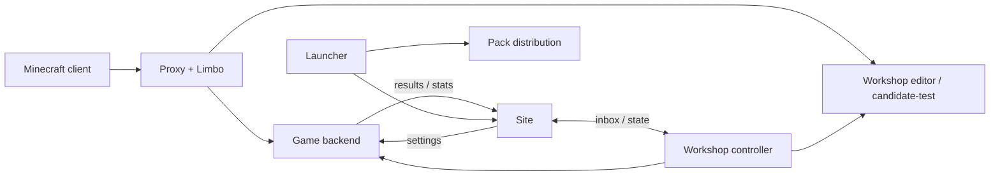

# Архитектура Blockfield

Публичная карта: какие юниты развёртываются, кто владеет данными и где
определены контракты. Подробности — в документации репозитория-владельца;
решения — в [docs/adr/](adr/). Код меняется в своём репозитории;
при изменении связи обновляйте эту карту и документ владельца контракта
([AGENTS.md](../AGENTS.md)).

Здесь нет топологии прода, имён хостов, портов, секретов и цен:
этот репозиторий публичный. Версии и SHA — из [.gitmodules](../.gitmodules),
[pins/](../pins/server.sha) и опубликованных манифестов, а не с этой страницы.

## Репозитории

Состав submodules задаёт [.gitmodules](../.gitmodules), см. [SUBMODULES.md](../SUBMODULES.md).

| Репозиторий                                                                                                                              | Роль                                                                           | Документация                                                                                                                                                                    |
| ---------------------------------------------------------------------------------------------------------------------------------------- | ------------------------------------------------------------------------------ | ------------------------------------------------------------------------------------------------------------------------------------------------------------------------------- |
| `blockfield-workspace` (этот)                                                                                                            | Dev/rig, harness, проверки, связь исходников                                   | [DEVELOPING](DEVELOPING.md)                                                                                                                                                     |
| `blockfield-client` (submodule `client/`)                                                                                                | Пины клиента, ресурсы, пак                                                     | [README](https://github.com/Blockfield/blockfield-client/blob/main/README.md), [release notes](https://github.com/Blockfield/blockfield-client/blob/main/docs/RELEASE-NOTES.md) |
| `blockfield-server` (private, пин в `pins/server.sha`)                                                                                   | Пины сервера, карты, образ, выпуск                                             | `docs/DEVELOPING.md`, `docs/DEPLOY.md` в репозитории сервера                                                                                                                    |
| `blockfield-mod` (submodule `localmods/blockfield-mod/`)                                                                                 | Игровая логика, сеть, клиентский интерфейс                                     | [CLAUDE](https://github.com/Blockfield/blockfield-mod/blob/main/CLAUDE.md), [AGENTS](https://github.com/Blockfield/blockfield-mod/blob/main/docs/AGENTS.md)                     |
| `Blockfield-Launcher` (отдельный репозиторий)                                                                                            | Tauri UI, аккаунт, установка игры/пака, deep links                             | [README](https://github.com/Blockfield/Blockfield-Launcher/blob/main/README.md), [DEVELOPMENT](https://github.com/Blockfield/Blockfield-Launcher/blob/main/docs/DEVELOPMENT.md) |
| `blockfield-releases` (отдельный репозиторий)                                                                                            | Публичные клиентские артефакты                                                 | [README](https://github.com/Blockfield/blockfield-releases/blob/main/README.md)                                                                                                 |
| `blockfield-proxy`, `blockfield-workshop`, `blockfield-site`, `blockfield-bot`, `blockfield-errors`, `blockfield-distribution` (private) | Proxy/Limbo, мастерская карт, сайт, Discord-бот, страницы ошибок, раздача пака | Документация в соответствующих приватных репозиториях                                                                                                                           |

## Юниты и владельцы данных

| Юнит                             | Владелец кода                                                 | Хранилище                                                                               |
| -------------------------------- | ------------------------------------------------------------- | --------------------------------------------------------------------------------------- |
| Game backend                     | `blockfield-server`, `blockfield-mod` (server)                | Локальные миры и конфиги образа; результаты матчей отправляет на сайт, сам их не хранит |
| Workshop editor / candidate-test | `blockfield-workshop` (controller), `blockfield-mod` (tablet) | Map CAS и активные heads у controller; game захватывает одну версию карты               |
| Proxy + Limbo-лобби              | `blockfield-proxy`                                            | Без durable-хранилища на этой карте                                                     |
| Site                             | `blockfield-site`                                             | PostgreSQL или SQLite: статистика, комнаты, настройки, админка                          |
| Launcher                         | `Blockfield-Launcher`                                         | Локальные профили и установленный пак                                                   |
| Pack distribution                | `blockfield-distribution`, `blockfield-client`                | Артефакты GitHub Releases; раздаётся текущий пак                                        |
| Discord bot                      | `blockfield-bot`                                              | См. `docs/DEPLOY.md` бота                                                               |
| Error pages                      | `blockfield-errors`                                           | Без хранилища                                                                           |

## Контракты

| Связь                                 | Определение                                                                                                                                                                          |
| ------------------------------------- | ------------------------------------------------------------------------------------------------------------------------------------------------------------------------------------ |
| Совместимость паков                   | Client `compatibility.json`, server `client-compatibility.json`; формат описан в `docs/DEPLOY.md` сервера                                                                            |
| Login-контракт пака                   | Mod [PackContract](https://github.com/Blockfield/blockfield-mod/blob/main/docs/DEVELOPMENT-REFERENCE.md) (`blockfield:pack_contract`); подробности в [ADR](adr/002-pack-contract.md) |
| Mod server ↔ mod client               | Fabric DTO и протокол в `common/.../network/`; контракт — [AGENTS](https://github.com/Blockfield/blockfield-mod/blob/main/docs/AGENTS.md), решения — [ADR](adr/002-pack-contract.md) |
| Только RakNet для игроков             | [ADR](adr/001-raknet-only-player-entry.md); транспорт принадлежит proxy                                                                                                              |
| Game и Workshop — разные backend      | [ADR](adr/003-workshop-separate-backend.md); lifecycle — workshop `docs/OPERATIONS.md`                                                                                               |
| Game → site: результаты и диагностика | Mod [PRODUCER](https://github.com/Blockfield/blockfield-mod/blob/main/docs/statistics/PRODUCER.md); приём — site `docs/statistics.md`                                                |
| Site → game: настройки                | Mod [admin-settings](https://github.com/Blockfield/blockfield-mod/blob/main/docs/admin-settings.md) (`settings.json` / `applied.json`)                                               |
| Site ↔ workshop: кандидаты карт       | Site `docs/admin.md`; controller `docs/OPERATIONS.md`                                                                                                                                |
| Комнаты и deep links                  | Launcher [ROOMS-AND-DISCORD](https://github.com/Blockfield/Blockfield-Launcher/blob/main/docs/ROOMS-AND-DISCORD.md)                                                                  |
| Текст релизов                         | Workspace `.github/actions/release-text`; формат — client [release notes](https://github.com/Blockfield/blockfield-client/blob/main/docs/RELEASE-NOTES.md)                           |
| TestBot — single source               | Workspace `scripts/dev/testbot`; the mod rig consumes it at a pinned commit (`dev/rig/testbot/testbot-pin.txt` in `blockfield-mod`)                                                  |

Решения с историей и проверенными фактами: [docs/adr/](adr/).
